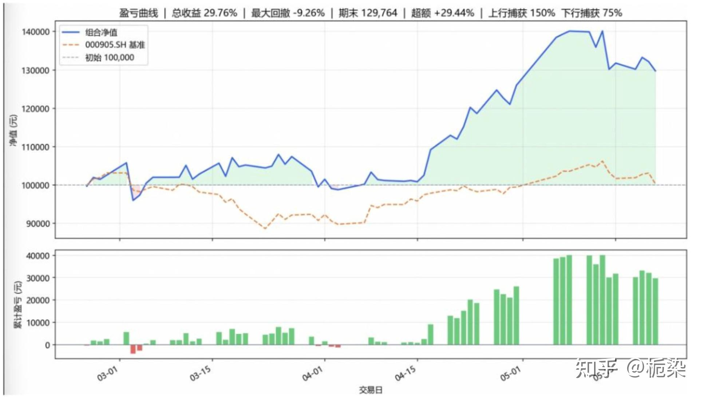

# 错位的量化金融 —— 第七章 实证 2：中证 500 指数增强

> 作者：栀染 ｜ 发布：2026-09-13 ｜ 赞同 37 ｜ 评论 6
> 原文：https://zhuanlan.zhihu.com/p/2082495795874613134

---

[错位的量化金融 —— 第六章 Stacking](https://zhuanlan.zhihu.com/p/2081772729208943209)

### 截面的奢侈

回到第四节那把尺子，择时和截面的分野。择时沿时间轴下注,沪铜十年也就两千多个交易日,宽度(breadth)薄得可怜,这正是我们当时对单品种 $\eta$ 要求苛刻、又只敢用 XGBoost 这种小模型的根本原因，样本太少,喂不动大模型,一喂就过拟合成第二节那个背诵的 LSTM。

截面把这件事彻底改写了。中证 500 是 500 只股票,每个交易日就是 500 个截面样本;十年下来,$500\times 2500=125$ 万个样本。样本量直接涨了三个数量级。这个量级,是第一次喂得动一个真正的深度模型而不立刻过拟合的量级。所以这一章前面被我们反复按住的深度学习,在截面这里终于可以正大光明地请出来 —— 但请出来的方式,依然要受这一章总纲的约束,我们待会儿就看到,它必须被”做弱”。

### 先把截面问题的形状看清楚

截面策略要预测的,不是明天涨不涨这个绝对方向,而是排序（rank）:在今天这个时间断面上,把 500 只股票按明天的相对强弱排个队。预测目标是

$Y_{i,t}=\text{rank}_i\big(r_{i,t+1}\big),\qquad i=1,\dots,500,$

也就是每只股票次日收益在当天截面里的分位。然后做多排在最前的一篮子、(指增里则是相对基准超配)、做空或低配排在末尾的 —— 赚的是相对强弱的钱,把市场整体的涨跌(beta)对冲掉。

这个”排序”的本质,决定了截面问题有一个择时根本没有的结构特征：每只股票的标签,依赖于当天所有其他股票。一只票排第几,不取决于它自己涨多少,而取决于它涨得比谁多、比谁少。预测是关于整个截面的、相对的,不是逐个独立的。把这件事记牢,它马上就要决定我们用什么模型。

### 为什么这次该用 Transformer？

先说反面。如果用 XGBoost 或普通 MLP 做截面,你只能一只一只股票地喂进去:输入这只票的因子,输出它的预测分数,然后对 500 只各算一遍。问题立刻来了 —— 模型在给 A 股票打分时,完全看不到 B、C、D 的存在。可截面预测的本质恰恰是”A 相对其他票如何”,你却把它做成了一个个孤立的、绝对的打分。模型必须从海量数据里间接地、费劲地反推出”哦原来这是个相对问题”,而它的结构压根没给它这个便利。这是一种结构和问题不匹配的别扭。

在量化交易领域臭名昭著的 Transformer 反而是最适合这个任务的模型。把当天 500 只股票作为一个集合(set)整个喂进去,每只票是一个 token,token 的特征就是它的 OHLCV + 上一节 stacking 出来的因子。注意力机制让每只票在被打分时,都能看到当天所有其他票,并自动学会我该和谁比、和谁的相对关系重要，这恰恰就是截面相对比较的本相。注意力在这里干的事,和上一节它在日内序列里挑关键时刻、和 MWU 在因子间分配信任,是同一种自适应地决定该关注谁的智慧,只不过这次是在同一截面的股票之间。

但真正深刻的、也是这个选择的点睛之笔,是去掉位置编码后的置换等变性(permutation equivariance)。Transformer 本来是为有顺序的序列(语言)设计的,所以配了位置编码去告诉它”谁在第几个”。可截面问题里,股票没有顺序 —— 你把 500 只票的输入顺序打乱,这件事在金融上没有任何意义,输出理应原样跟着打乱、每只票的预测值分毫不变。这个性质,数学上就叫置换等变:

$f(P\cdot X)=P\cdot f(X),\quad \text{对任意置换矩阵 }P.$

而一个去掉了位置编码的 Transformer,天然、精确地满足这个性质 —— 注意力对它的输入集合本就是对称的,位置编码是唯一打破这个对称的东西,去掉它,等变性就免费到手。

一个模型的归纳偏置(inductive bias)越是贴合问题本身的对称性,它就越不需要从数据里去”学”这个对称性,省下来的全部容量和样本都能花在真正的信号上。截面问题的对称性就是”对股票置换不变”,而无位置编码的 Transformer 把这个对称性焊进了架构 —— 它从结构上就知道”换个顺序是同一个问题”,根本不必浪费一个样本去学这件显然的事。这是 XGBoost 给不了的(它逐票打分,根本没有”截面”这个对象),也是普通 MLP 给不了的(把 500 只票拼成一个长向量喂进去,顺序一变输出就全乱,它得用海量数据去硬学那个本该免费的对称性)。 只有注意力这个结构,恰好和截面问题的形状严丝合缝。

所以这一节的模型选择,又是这一章总纲的一次精确应用,而且这次格外清晰:Transformer 的注意力结构对路(截面就是相对比较、就该置换等变),所以用它;但信息依然稀薄(**$\eta$** 还是那个 **$10^{-3}$** 量级的小数),所以必须把它做弱。 结构选择和容量控制,是两个独立的决定:前者问”这个模型的归纳偏置配不配问题的形状”,后者问”数据撑不撑得起这么大的容量”。截面让我们第一次能对前者说”完美匹配”,但对后者,答案依然是”小心,信息很薄”。

### 怎么把 Transformer 做弱

样本量涨了三个数量级,不等于过拟合的威胁消失了 —— 因为 $\eta$ 没变,真信号还是那么薄,样本多了只是让你够得着一个深模型,不是让你可以放纵它。做弱的手段,全是第三节那条泛化界 $R\le\hat R_n+2\mathfrak R_n(\mathcal H)+\dots$ 的直接应用,核心就一句:往死里压 **$\mathfrak R_n(\mathcal H)$**。

具体到这个 Transformer:

1. 层数浅(2–4 层足够,不堆几十层)、宽度窄、注意力头不多
2. dropout 开得比 NLP 里重得多
3. rmsnorm+low rank decay

一个浅、窄、重正则、早停的 Transformer,容量可能还不如一个深 MLP,但它有 MLP 永远没有的那个对称性。正确的结构和克制的容量就是截面模型的配方。

### 损失函数

end-to-end 还差最后一块拼图:损失函数。最容易犯的错,是顺手用 MSE 去拟合次日收益 —— 这又踩第二节”预测精确数值”的坑。你根本不在乎模型把某只票的收益预测成 +2.1% 还是 +2.3%,你只在乎它把该买的排在前面、该卖的排在后面。MSE 会逼模型把容量浪费在精确拟合那些在交易上毫无意义、信息上又不可约的收益小数上,正是第二节那个 7.7 比特里 99.98% 是噪声的老故事。

正确的做法是让损失函数直接对齐你赚钱的那个量 —— 也就是 IC / 排序。最直接的是 IC loss:直接把”预测分数和真实收益在当天截面上的相关系数”取负当损失,模型优化什么,你考核它什么,完全一致:

$\mathcal L_{\text{IC}}=-\,\frac{1}{T}\sum_{t}\text{corr}\big(\hat s_{\cdot,t},\,r_{\cdot,t+1}\big).$

更贴合指增、且更稳健的,是直接优化排序的 rank/listwise loss(借鉴 learning-to-rank 那套),或者干脆把目标定成”我构造的多头组合相对基准的超额收益的夏普”。这一步的哲学,和上一章三重屏障、和这一章每一处打标,完全是同一条:把目标从”复述数值”换成”只问你真正要的那个相对结构”，压低分母 $H(Y)$,把容量留给真信号。

### 实盘

笔者曾使用端到端 Transformer 结合筹码因子实盘，以下为实盘数据。

### 为什么截面指增是这一章方法论的最佳归宿

收个尾,把这一节放回全章的脉络。指增能成,靠的是 $\mathrm{IR}\approx\mathrm{IC}\cdot\sqrt{\text{breadth}}$ 里那个截面天生巨大的 breadth —— 500 只票就是 500 个近独立的下注,哪怕每只票的 IC 低到 0.03、单看薄得可怜,$\sqrt{500}\approx 22$ 倍的宽度放大,也能把它撑成一个可观、平稳的信息比率。这就是第四节说的”截面知易、择时知难”:同样薄的 $\eta$,截面用宽度把它兑现成了稳定的钱,而我们的沪铜择时得在低宽度里苦苦挣扎。

数据充足(让深模型成为可能)、结构对路(让注意力配得上截面)、容量克制(让薄信号不被噪声淹没)、目标诚实(让优化的就是赚钱的)、宽度巨大(让薄 alpha 兑现成稳钱) —— 这五件事在中证 500 指增上同时凑齐,这就是为什么截面指增,是这一整章信息论方法论最舒展、最有说服力的一个归宿。

到此我们有了两个完整的实证策略:低宽度、知难而上的沪铜择时,和高宽度、五件事俱全的中证 500 指增。但两者都还停在”模型打分”到”组合持仓”的交界上含糊带过，那层solve qp里的组合优化,我们一直当黑箱使。下一节就把这个黑箱彻底打开。

[链接](https://zhuanlan.zhihu.com/p/2082496542213149301)
