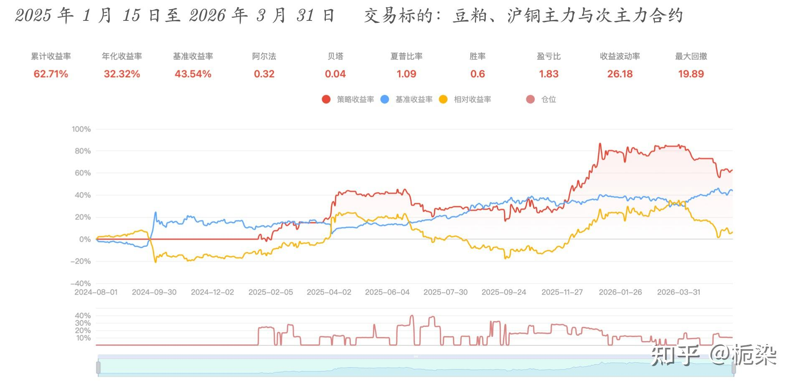

# 错位的量化金融 —— 第三章 实证：第一个策略

> 作者：栀染 ｜ 发布：2026-09-09 ｜ 赞同 75 ｜ 评论 3
> 原文：https://zhuanlan.zhihu.com/p/2081075102767116868

---

[错位的量化金融 —— 第二章 为什么我们需要特征工程和打标](https://zhuanlan.zhihu.com/p/2080451625383093223)

在写第一个策略之前，要先把 Trend 这个大类再切一刀。前面我们一直笼统地说预测方向，但方向这个词底下藏着两种做法完全不同的活计，它们对应的可学习性来源也不一样。

### 择时与截面

第一种叫择时（timing），又叫时序策略。它盯住单一资产，沿着时间轴问一个问题：这个东西，现在该多还是该空？沪铜明天往上还是往下，就是一个择时问题。它预测的随机变量是 $Y_t=\mathrm{sign}(\Delta_{t+1})$，下标是时间。

第二种叫截面（cross-section）。它在每一个时间断面上，把一篮子资产横着排个队：这一刻，哪些品种相对强、哪些相对弱？然后做多排在前头的、做空排在末尾的，赚的是它们之间相对强弱的收敛与延续，而不赌整个篮子的涨跌（这一步顺带把市场 beta 对冲掉了）。它预测的是排序，标签往往是截面收益的分位。著名的动量、价值、carry 三因子，最初都是在股票截面上提出来的。

两者在信息论上的差别很实在。截面策略的宽度天生就大，同一时刻几十个品种就是几十个近独立的下注，按 $\mathrm{IR}\approx\mathrm{IC}\cdot\sqrt{\text{breadth}}$，哪怕单品种 IC 低到 $0.02$，宽度也能把它撑起来。而择时策略的宽度只来自时间，下注次数受换手和自相关的双重压制，所以它对单笔的可学习性要求更苛刻。我们第一个策略选择做沪铜的单品种择时，恰恰是知难而上，单品种、低宽度，是检验一套因子和打标到底有没有真信息的最严苛的考场。如果在这里 $\eta>0$，挪到截面上去几乎稳赚；反过来则不一定成立。

> 顺便一提，Trend 之下还有第三支，事件驱动——盯着财报、移仓换月、限仓这类离散事件做。它本质是把 $\Phi$ 的定义域从连续时间换成事件时间，框架不变，本书后面再单独谈。

### 给沪铜配几把尺子

回到上一节的分式 $\eta=I_{\mathcal V}(\Phi\to Y)/H(Y)$。打标我们已经有了三重屏障，分母按住了；现在要往分子里灌信息，也就是给沪铜配一组因子 $\Phi$。我们分三层来配。

最底下一层是 OHLCV —— 开高低收量，原始数据。它本身不是因子，但它是所有价量因子的母体，而且树模型能从原始的高低收里读出一些手工因子未必写得出的形态（比如当日振幅 $(H-L)/C$ 隐含的波动状态），所以直接喂进去不亏。

中间一层是价量衍生因子，也是择时策略的主力。这里有个看似平凡、实则要命的设计决定：**多周期**。我们不只算一条均线，而是算一组：

$\mathrm{MA}_w=\frac1w\sum_{i=0}^{w-1}C_{t-i},\qquad w\in\{5,10,20,60\},$

并取价格相对各条均线的乖离 $C_t/\mathrm{MA}_w-1$；动量也不只取一个回看期，而是一组对数收益：

$r_w=\log C_t-\log C_{t-w},\qquad w\in\{1,5,10,20,60\}.$

为什么非要多周期？这背后是一个关于模型本质的、初学者几乎都会踩的坑。**XGBoost 是无状态的（stateless）——它每一次推理都是独立的一锤子买卖，它看不见自己上一次推理，更没有任何跨样本的记忆。** 这和 LSTM 不一样。LSTM 理论上能把「我现在正处在一段上涨趋势的第几天」这种状态藏在隐藏态 $h_t$ 里一路带下去；而 XGBoost 在 $t$ 时刻拿到的，只有 $t$ 这一行特征向量，仅此而已。它不知道昨天它看到了什么，也不知道这波趋势已经走了多久。

于是，所有关于「市场当前处在什么状态」的信息，你必须想办法压进**当前这一个快照**里，否则模型永远读不到。多周期就是干这个的：单看 $r_5$ 你不知道这是回调还是反转，但当 $r_5>0$ 而 $r_{60}<0$，这个组合就在一行之内编码出了「长期下行中的短期反弹」这一相位（phase）；$r_5,r_{20},r_{60}$ 同号且递增，又是另一种相位。多周期特征，本质是用空间维度（一行里的多个列）去替代模型缺失的时间记忆，把本该靠状态承载的信息，摊平成无状态模型也能一眼看全的横截面。理解了这一点，你就明白为什么对树模型做特征工程时，「同一个量、多个窗口几乎是标配——这不是堆特征凑数，是在给一个失忆的模型重建它的记忆。

最上面一层，才是真正把沪铜和「随便一只股票」区分开的东西：期货特有因子。期货有现货所没有的结构，丢掉就太可惜了。

其一是期限结构 / carry。同一时刻，近月和远月合约价格不同，二者的斜率就是展期收益（roll yield）。设近月价 $F_{\text{near}}$、远月价 $F_{\text{far}}$、间隔 $\tau$ 个月，

$\text{carry}_t=\frac{1}{\tau}\Big(\frac{F_{\text{near}}}{F_{\text{far}}}-1\Big).$

这个因子在期货里是有经济学意义的，现货溢价（backwardation，近高远低）通常对应库存紧张、需求旺盛，是结构性看多信号；期货溢价（contango）反之。它的可预测性来自风险溢价和库存逻辑，不是定价错误，所以不容易被套掉——正是上一节说的那种「幸存的漂移」。

其二是基差动量（basis momentum），近月与远月各自累计收益之差的动量，捕捉的是期限结构本身在变陡还是变平。其三是持仓量（open interest）的变化与量价配合——$\Delta\text{OI}$ 配合价格涨跌，能区分是新资金进场推动（增仓上涨）还是空头回补的虚涨（减仓上涨），这是纯股票数据里没有的维度。沪铜还有库存/仓单数据可用，逻辑上直通 carry，本节先用价量和期限结构起步，库存留作练习。

把这三层拼起来，就是我们的特征矩阵。下面开始搭。

```
import numpy as np
import pandas as pd
import xgboost as xgb

def build_factors(df):
    f = pd.DataFrame(index=df.index)
    c = df["close"]
    f["ret1"]   = np.log(c).diff()
    f["amp"]    = (df["high"] - df["low"]) / c            # 当日振幅
    f["vol_z"]  = (df["volume"] - df["volume"].rolling(20).mean()) \
                  / df["volume"].rolling(20).std()        # 成交量异动
    for w in (5, 10, 20, 60):
        f[f"bias_{w}"] = c / c.rolling(w).mean() - 1      # 乖离
    for w in (1, 5, 10, 20, 60):
        f[f"mom_{w}"]  = np.log(c) - np.log(c.shift(w))   # 动量
    f["rv20"] = f["ret1"].rolling(20).std()
    f["carry"]  = (df["near_close"] / df["far_close"] - 1) / df["tau"]
    f["basmom"] = (np.log(df["near_close"]).diff(20)
                   - np.log(df["far_close"]).diff(20))    # 基差动量
    f["doi"]    = df["oi"].pct_change()                   # 持仓量变化
    f["pv"]     = np.sign(f["ret1"]) * f["doi"]           # 量价配合
    return f
```

打标用上一节的三重屏障。注意屏障宽度按 $\sigma_t=\text{rv20}$ 缩放，这样高低波动期的标签可比；垂直屏障取 $h=10$ 个交易日。

```
def triple_barrier(close, rv, up=2.0, dn=2.0, h=10):
    n = len(close); y = np.zeros(n)
    p = close.values; s = rv.values
    for i in range(n - h):
        if not np.isfinite(s[i]) or s[i] == 0:
            y[i] = np.nan; continue
        hi = p[i] * (1 + up * s[i])      # 上屏障(止盈)
        lo = p[i] * (1 - dn * s[i])      # 下屏障(止损)
        path = p[i+1 : i+1+h]
        hit_up = np.argmax(path >= hi) if (path >= hi).any() else h + 1
        hit_dn = np.argmax(path <= lo) if (path <= lo).any() else h + 1
        if   hit_up < hit_dn: y[i] = 1   # 先碰上屏障
        elif hit_dn < hit_up: y[i] = -1  # 先碰下屏障
        else:                 y[i] = 0    # 谁也没碰到, 时限到
    return pd.Series(y, index=close.index)
```

剩下的就是把因子和标签对齐，做一次**严格按时间切分**的训练（绝不能随机打乱，否则就是拿未来预测过去），然后扔给 XGBoost。三重屏障给了三个类别 $\{-1,0,1\}$，正好用多分类。

```
X = build_factors(df)
y = triple_barrier(df["close"], X["rv20"])
data = X.join(y.rename("y")).dropna()
data["y"] += 1                            # 映射到 {0,1,2} 供 multi:softprob

split = int(len(data) * 0.7)              # 前 70% 训练, 后 30% 样本外
tr, te = data.iloc[:split], data.iloc[split:]
feat = [c for c in X.columns]

model = xgb.XGBClassifier(
    objective="multi:softprob", num_class=3,
    n_estimators=300, max_depth=4,        # 浅树, 别让它背诵
    learning_rate=0.03, subsample=0.8,
    colsample_bytree=0.8, min_child_weight=20,
    reg_lambda=2.0,                       # 都是在压 H(Y|Φ) 里的过拟合项
)
model.fit(tr[feat], tr["y"])
proba = model.predict_proba(te[feat])    # 取 P(上) - P(下) 作为仓位信号
signal = proba[:, 2] - proba[:, 0]
```

注意我把树压得很浅，因为 $\mathcal L=H(Y\mid\Phi)+D_{\mathrm{KL}}$ 里，死死按住模型去拟合那个不可约噪声项的冲动。$\eta$ 本来就只有千分之几，容量稍微一放开，它就去背诵了，这就是 LSTM 那一节的覆辙，跟模型种类无关。

### 为什么 XGBoost 这种土模型反而行

这里要回答一个让很多人别扭的问题。XGBoost 是个土模型——没有表示学习，没有注意力，一堆决策树投票而已，2016 年的技术。可它偏偏是国内几乎所有中小私募实盘在用的东西，深度学习在量价择时上反复被它按在地上摩擦。为什么？

答案在前两节其实已经埋好了。模型的优劣，从来是相对于 **$\eta$** 而言的，而不是绝对的。 深度学习的看家本领是表示学习——从原始数据里自动学出好的特征。但这套本领有用的前提是：好特征藏在原始数据里，等着被学出来。可我们的情况恰恰相反：我们已经用三层因子工程，把信息亲手喂到了模型嘴边，$\Phi$ 本身就是精心提炼过的、信息密度很高的特征。这时候，自动学特征这个深度学习最值钱的能力，无用武之地——信息不在原始数据里等着学，它已经在 $\Phi$ 里了。剩下要做的只是一件简单得多的事：在这组已经很强的因子上，把决策面拟合出来。

而这件简单的事，恰恰是树模型的主场。从机器学习理论看，每种模型都自带一个归纳偏置（inductive bias），它假定真相长什么样。神经网络假定真相是光滑的、可组合的函数；而梯度提升树假定真相是少数因子在若干阈值上分段、并彼此交互的分段常数函数。问题是 —— alpha 因子真实的作用方式，几乎就是后者那个样子。carry 不是线性地一路看多，它常常是足够 backwardation 才有用、否则没用的阈值效应；动量在高波动区间会反转，是典型的因子之间的状态依赖交互。树的归纳偏置，撞上了金融表格数据的真实结构；而神经网络的光滑先验，在这种充满阈值与突变、又没有平移/局部性结构可言的数据上，是个错误的先验。先验对不对，比模型容量大不大重要得多，尤其当 $\eta$ 这么小、样本这么少的时候，错误的先验会把本就微薄的信息预算浪费在拟合噪声上。

还有一层更朴素的工程理由，也是私募真正在乎的，即给因子很大的自由发挥空间。树对单调变换免疫（不用做标准化）、天然处理缺失值（停牌、数据缺失直接进一条默认分支）、对量纲和离群点不敏感、训练快、能直接读特征重要性。这意味着研究员可以毫无心理负担地往里塞因子：塞进去有用就留、没用 XGBoost 自己会把它的分裂增益压到零。它把因子的筛选、非线性、交互这三件本来要人工设定函数形式的脏活全包了，对一个三五个人、要快速迭代上百个因子想法的小私募来说，这种你只管造因子，剩下交给我的工作流，价值远超那零点几个百分点的理论 AUC。

Tips: 既然 XGBoost 的全部职责是消费因子、而它一个比特的新信息都创造不了（DPI 管着呢），那么策略的天花板就完全压在 $\Phi$ 上——这也回到了赚钱最重要的是特征工程。所以第一条改进永远是造更好的因子，而不是换更炫的模型。

但还有一条更巧、也更贴合这个 view 的改进，值得提一句。我们说树的好处是给因子很大的自由，可自由是把双刃剑，在 $\eta$ 这么低的地方，过度的自由就是过拟合的同义词。而你其实手里攥着免费的先验——你明明知道 carry 越高越该看多、这个方向不该反过来。把这种你已经确信的经济学符号，用单调约束（monotonic constraints）直接钉进模型：

```
model = xgb.XGBClassifier(..., monotone_constraints={"carry": 1})
```

从学习理论看，这一步干的事是把假设空间砍掉一大半——它禁止模型学出任何carry 升高反而更看空的、几乎必然是噪声拟合出来的决策面。在拟合优度不变的前提下缩小假设类，泛化误差的上界（VC / Rademacher 那一套）随之下降；换成上一节的话，就是你用真实的先验，替模型省下了本来要花在不可约噪声上的容量。这恰恰是利用了 XGBoost 给因子太多自由这个特点的反面 —— 你看清了它自由过头的地方，就知道该在哪里收一收。更激进的同源思路（学一层特征表示再喂给树、meta labeling、给损失换成贴合三重屏障非对称性的目标），都是同一个判断的延伸，模型这一环已经够用了，所有的边际要么在因子里，要么在你注入的先验里。

### Meta-labeling

回头看我们那个信号 `proba[:,2] - proba[:,0]`。它其实把两个性质完全不同的决策，偷偷塞进了一个数里：方向（该做多还是做空）和力度（这一把到底该不该下、下多重）。一个端到端的多分类 XGBoost，被迫用同一套树、同一个假设空间，同时把这两件事都办了。这看起来很经济，但从学习理论的角度看，它把本该分开的两笔账并成了一笔糊涂账——而且并错了方向。

López de Prado 的 meta-labeling 就是解决这个问题的。它把交易决策显式地分解成

$F(x)\;=\;\underbrace{s(x)}_{\text{方向}\in\{\pm1\}}\;\cdot\;\underbrace{m(x)}_{\text{力度}\in[0,1]},$

然后让两个模型分头负责。主模型（primary）只管定方向 $s$ —— 它甚至可以就是个朴素规则，比如 $s=\mathrm{sign}(\mathrm{mom}_{20})$，或者我们上面那个 XGBoost 取个符号。主模型刻意调成高召回（high recall）：宁可多触发、错杀从宽，把所有看起来有戏的机会都先捞进来。然后次级模型（meta model，又叫 sizing model）登场，它干一件、且只干一件事：在主模型已经给定方向的前提下，预测这一把主模型对的概率 $P(\text{primary correct}\mid \Phi)$，再拿这个概率去做闸门和仓位。它的标签不是涨跌，而是主模型这次押对了没有：

$Y_{\text{meta}}\;=\;\mathbb 1\big[\,\text{按 } s \text{ 方向的那一笔，先碰到了顺向的三重屏障}\,\big]\;\in\{0,1\}.$

注意这是个干净的二元标签。$H(Y_{\text{meta}})\le 1$ 比特，而且通常类别还偏斜（多数信号是该放弃的），熵更低。这一步本身就接上了第二节的老逻辑：它在压分母。但 meta-labeling 真正深刻的地方不在信息论，而在 VC / Rademacher，它从根上改变了你要付的泛化代价。

把那条标准的 Rademacher 泛化界摆出来。对取值在 $[0,1]$ 的损失、假设类 $\mathcal H$，以至少 $1-\delta$ 的概率，对类中所有 $h$，

$R(h)\;\le\;\hat R_n(h)\;+\;2\,\mathfrak R_n(\mathcal H)\;+\;3\sqrt{\frac{\log(2/\delta)}{2n}}.$

我们的处境是 $n$ 小、$\eta$ 低到千分之几——这意味着经验风险 $\hat R_n$ 几乎压不下去（信号本就稀薄），泛化能不能成，全看后面那个复杂度项 $\mathfrak R_n(\mathcal H)$ 能不能摁住。换句话说，在这个行当里，唯一能赢的方式是把假设类的复杂度往死里砍，而不是把训练误差往死里压（往死里压，就是 LSTM 那一节的背诵）。

现在看端到端那个方案的麻烦在哪。要让一个模型输出「带符号、又分轻重」的仓位，它的假设类 $\mathcal H_{\text{full}}$ 必须同时具备两种表达力：分得清方向，还要刻画得出力度的连续梯度。后者尤其贵 —— 你越想让仓位该重的时候重、该轻的时候轻，就越得放开模型容量，而 $\mathfrak R_n$ 是按**整个** $\mathcal H_{\text{full}}$ 算的，方向和力度的复杂度在这里是绑死的、一起进账。于是你被逼着用一个高复杂度的类，去拟合一个 $\eta$ 极低的目标 —— 泛化界右边那项直接爆掉。

meta-labeling 把这根绑死的绳子剪断了。方向 $s$ 由主模型承担，而主模型可以是个零 VC 维的规则（一条 $\mathrm{mom}_{20}$ 的符号，假设类就一个函数，$\mathfrak R_n\approx 0$）；力度 $m$ 则被单独隔离进一个**二元分类**的小类 $\mathcal H_{\text{meta}}$。这个类你可以蓄意做得极小，这就是必须用深度 2 的浅树、三五个特征的原因。于是真正决定你资金曲线的那个力度决策，它的泛化代价由 $\mathfrak R_n(\mathcal H_{\text{meta}})$ 控制，而

$\mathfrak R_n(\mathcal H_{\text{meta}})\;\ll\;\mathfrak R_n(\mathcal H_{\text{full}}).$

差距来自三处叠加：其一，二元输出的复杂度（Natarajan / 伪维度那一套）天然低于带符号的多档置信那种准多分类输出；其二，你可以主动把 $\mathcal H_{\text{meta}}$ 限到很小，反正它不用再操心方向；其三，它的目标 $Y_{\text{meta}}$ 是个良态的平衡二分类，损失面比稀薄的多分类方向好走得多。meta-labeling 把模型容量从方向挪到了力度，又把力度这件最贵的事关进了一个最小的假设类里。

这也给了主模型要高召回一个学习理论上的解释，而不只是 López de Prado 的经验之谈。让主模型高召回，等于允许它的错误全部是假阳性（多捞了不该做的机会），而不是假阴性（漏掉了真机会）。而消除假阳性，是一个单边的二分类问题：次级模型只需把 $P(\text{correct})$ 的阈值往保守里调，就能用召回换精度，把假阳性筛掉；这个调阈值的操作，是在一个低复杂度类上挑工作点，不额外增加 $\mathfrak R_n$，几乎免费。反过来，假阴性是漏掉的钱，找不回来，但它不像错误的仓位那样直接乘进你的盈亏里。于是整套设计的资源分配变得无可挑剔：复杂度的预算，花在了召回（便宜）上；而那个直接乘进 P&L、最经不起过拟合的力度决策，被保护在了最干净、最小的假设类里。

落到代码上，它只是在原策略后面再续一截。主模型给方向，次级模型学闸门：

```
side = np.sign(proba[:, 2] - proba[:, 0])          # +1 / -1
y_meta = ((side ==  1) & (y_raw ==  1) |
          (side == -1) & (y_raw == -1)).astype(int)
meta = xgb.XGBClassifier(
    objective="binary:logistic",
    max_depth=2, n_estimators=150, learning_rate=0.03,
    min_child_weight=50, reg_lambda=4.0,
)
meta.fit(Xtr_meta, ytr_meta)                        # 特征里把 side 也喂进去
p_correct = meta.predict_proba(Xte_meta)[:, 1]
position  = side * np.where(p_correct > 0.55, p_correct, 0.0)  # 按置信定仓
```

到这里，我们这个沪铜择时策略已经五脏俱全：方向而非价格的打标、抬分子压分母的因子工程、先验对路的土模型、再加一层 meta-labeling 把仓位决策保护起来。可它依然是一个赌注 —— 一个品种、一套因子，$\eta$ 再正，也扛不住一次风格切换或一段因子失效。下一节我们正面处理那个一直被推迟的问题：既然单因子的边际薄得可怜，到底怎么靠宽度和正交化，把一地碎银堆成一条平稳的资金曲线——以及随之而来的、会把无数人骗进去的 factor zoo 与多重检验陷阱。

回测结果：



[链接](https://zhuanlan.zhihu.com/p/2081433899159250399)
